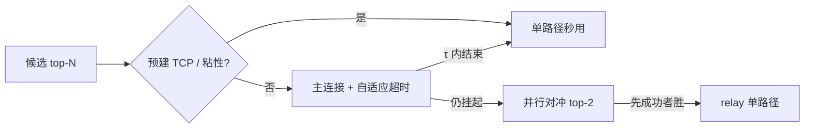

# 隧道稳定性优化 — 实现说明

> 范围：`tunnel/server.py` 建连/切 IP 路径  
> 已实现：**自适应建连超时 + 建连对冲**  
> 明确不做：熔断器（IP TTL 仅 30s 级，`fail_count` 降权 + 连败踢出已覆盖；短命 IP 上动态冷却收益有限、复杂度高）  
> 原则：只动建连选路层；relay、粘性语义、踢出策略兼容；特性可开关回滚。

---

## 1. 背景

原串行 failover（`_open_upstream_with_failover`）的长尾来自：

1. **固定建连超时 1.0s** — 半死 IP 上干等满超时才切  
2. **串行试错** — 前面慢 IP 把 6 次预算耗光，好 IP 排不上  

本实现用两招对症：

| 特性 | 解决什么 |
|---|---|
| **自适应建连超时** | 不在慢 IP / 将死 IP 上干等 |
| **建连对冲** | 主出口挂起时并行拉备用，先通者胜 |



---

## 2. 自适应建连超时

### 2.1 公式

```
rem = entry.remaining()
base_lat = ewma_latency_ms 或 latency_ms 或 1000ms

t1 = clamp(α × base_lat/1000 + β, MIN, MAX)   # 历史延迟
t2 = max(0.15, rem × REM_RATIO)               # 剩余 TTL 封顶
timeout = min(t1, t2)
```

| 配置 | 默认 | 含义 |
|---|---|---|
| `ADAPTIVE_TIMEOUT_ENABLED` | `True` | 关闭则回退 `TUNNEL_CONNECT_TIMEOUT` |
| `TUNNEL_CONNECT_TIMEOUT_MIN` | `0.35` | 最快不短于 350ms |
| `TUNNEL_CONNECT_TIMEOUT_MAX` | `1.5` | 最慢不超过 1.5s |
| `ADAPTIVE_ALPHA` | `0.6` | 历史延迟权重 |
| `ADAPTIVE_BETA_S` | `0.25` | 固定开销 |
| `ADAPTIVE_REM_TIMEOUT_RATIO` | `0.4` | 等待不超过剩余寿命的 40% |

### 2.2 效果（实测）

| 场景 | rem | EWMA | 超时 |
|---|---|---|---|
| 快 IP | 25s | 200ms | **0.37s** |
| 慢 IP | 25s | 2000ms | **1.45s** |
| 未测新 IP | 28s | — | **0.85s** |
| 濒死 | 2s | — | **0.80s**（TTL 封顶） |

超时**不**写入 EWMA（不是有效延迟样本）。  
TCP + 上游 CONNECT 响应头读取使用同一 timeout。

### 2.3 落点

- `TunnelServer._connect_timeout_for(entry)`
- `_open_upstream` 内 `asyncio.wait_for(..., timeout=...)`

---

## 3. 建连对冲（Hedge Connect）

### 3.1 策略

**只对冲「拿到上游通道」，不对冲业务字节流。**

| 做 | 不做 |
|---|---|
| 主连接挂起 `HEDGE_DELAY_MS` 后并行 top-2 | 复制 HTTP body / 双发请求 |
| 先成功者胜，败者 `close()`（含 CancelledError 收口） | relay 双活 |
| 胜者写粘性 / 统计 | 因输掉对冲踢 IP |

### 3.2 触发条件

同时满足才对冲：

1. `HEDGE_ENABLED=True` 且 `HEDGE_DELAY_MS>0`
2. 无粘性命中（粘性 = 严格单出口）
3. 候选剩余 ≥ 2
4. 全局对冲在途 < `HEDGE_MAX_INFLIGHT`

主连接若在 τ 内结束（成功或失败）→ **不拉对冲**，保持单路径语义。  
预建 TCP 命中本就极快，同样不会触发对冲。

### 3.3 胜负与记账

| 事件 | 统计 | 失败记账 |
|---|---|---|
| 主连接 τ 内成功 | `first_ok`（首试） | — |
| 对冲方胜 | `hedge_saved` | 败者不 `mark_success` |
| 主连接胜（对冲已启动） | `hedge_wasted` | 败者不记成功 |
| 主连接 τ 内失败 | 走 failover 下一批 | 只 `mark_fail` **实际尝试过的** |
| 对冲双方皆败 | — | `_AttemptError.attempted` 列出的 IP 才 `mark_fail` |

实现上失败路径抛 `_AttemptError(cause, attempted)`，failover 只对 `attempted` 记失败/踢出，避免误伤未启动的候选。

### 3.4 配置

| 配置 | 默认 | 含义 |
|---|---|---|
| `HEDGE_ENABLED` | `True` | 总开关 |
| `HEDGE_DELAY_MS` | `120` | 主连接挂起多久后对冲 |
| `HEDGE_WIDTH` | `2` | 含主连接（上限 3） |
| `HEDGE_MAX_INFLIGHT` | `32` | 全局对冲建连上限 |

### 3.5 落点

- `TunnelServer._open_upstream_hedged` — 对冲裁决
- `_open_upstream_with_failover` — 粘性判断、分组、`_AttemptError` 记账
- `TunnelStats.hedge_*` → `/api/tunnel` 的 `hedge` 字段
- `status()` 额外暴露 `adaptive_timeout` / `hedge_enabled` / `hedge_delay_ms`

---

## 4. 与现有机制关系

| 机制 | 关系 |
|---|---|
| 热池预建 TCP | 命中则快路径，不对冲 |
| 粘性 IP | 命中则单出口，不对冲；胜者仍 `_bind_sticky` |
| `fail_count` / 踢出 | 不变；对冲败者若硬失败可踢，软失败只累加 |
| `KICK_PAUSE_RATIO` | 不变 |
| `first_ok` / `first_fail` | 首试成功且未依赖对冲才计 `first_ok` |
| relay / stall | 完全不动 |

---

## 5. 为什么不做熔断

| 原因 | 说明 |
|---|---|
| TTL 太短 | IP 只活 30s 级，固定/动态冷却都容易「冷却没到就过期」 |
| 已有降权 | `fail_count>0` 沉底 + 连败 3 次踢 + 硬失败快踢 |
| 对症已够 | 自适应超时压掉「干等」，对冲压掉「串行踩坑」 |
| 复杂度 | 三态状态机 + 剩余 TTL 公式 + 半开预算，收益/成本比低 |

若日后出现「池子很小 + 慢 IP 成簇」再捡回熔断即可，接口上 `_pick_candidates` 加一个跳过集就行。

---

## 6. 配置全文（`config.py` 增量）

```python
# ---- 自适应建连超时（按历史延迟 + 剩余 TTL 封顶）----
ADAPTIVE_TIMEOUT_ENABLED = True
TUNNEL_CONNECT_TIMEOUT_MIN = 0.35
TUNNEL_CONNECT_TIMEOUT_MAX = 1.5
ADAPTIVE_ALPHA = 0.6
ADAPTIVE_BETA_S = 0.25
ADAPTIVE_REM_TIMEOUT_RATIO = 0.4

# ---- 建连对冲（只对冲 CONNECT，不对冲业务字节流）----
HEDGE_ENABLED = True
HEDGE_DELAY_MS = 120
HEDGE_WIDTH = 2
HEDGE_MAX_INFLIGHT = 32
```

回滚：

- 关自适应：`ADAPTIVE_TIMEOUT_ENABLED=False`（回到固定 `TUNNEL_CONNECT_TIMEOUT`）
- 关对冲：`HEDGE_ENABLED=False` 或 `HEDGE_DELAY_MS` 设很大

---

## 7. 验证记录

语法：`py_compile tunnel/server.py config.py` 通过。

冒烟（mock 建连）：

| 用例 | 结果 |
|---|---|
| 快/慢/未测/濒死 IP 超时落在预期区间 | ✅ 0.37 / 1.45 / 0.85 / 0.80 |
| 主慢备快 → 对冲方胜，`hedge_saved=1` | ✅ |
| 主快 → 不对冲，只调主 | ✅ |
| 主快败 → 仅记 primary attempted | ✅ |
| 主慢败 + 备败 → attempted=[primary,secondary] | ✅ |

---

## 8. 后续可选

1. `HEDGE_DELAY_MS` 按 P50 建连耗时自适应（`clamp(0.35×P50, 60, 200) ms`）  
2. 建连耗时序列进 `utils/metrics`，前端展示 `hedge_saved/wasted`  
3. 池水位低时自动关对冲（少浪费候选）  
4. 半开熔断（若慢 IP 成簇再上）

---

*文档版本：v2.0 · 实现对应 `config.py` + `tunnel/server.py` · 冒烟已过*  
*v1.x 的熔断章节已移除，见 §5*
